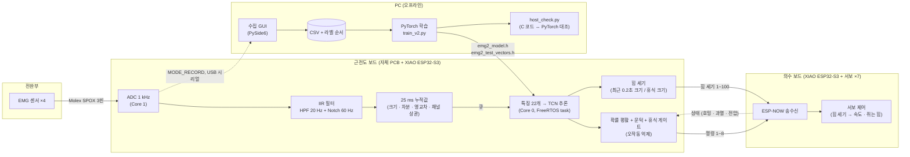
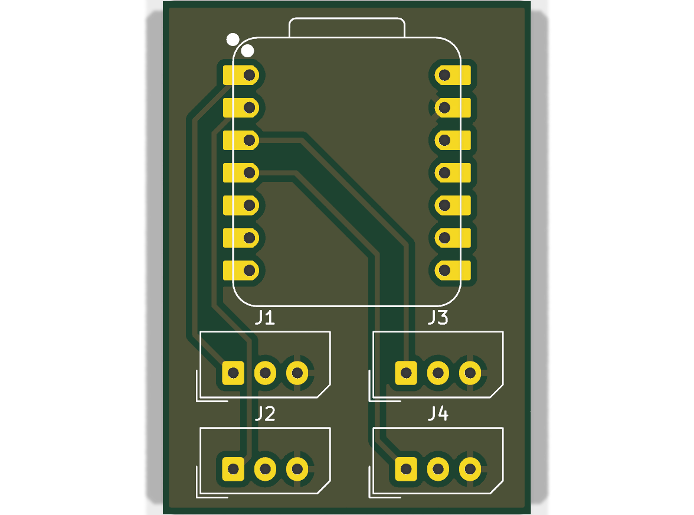
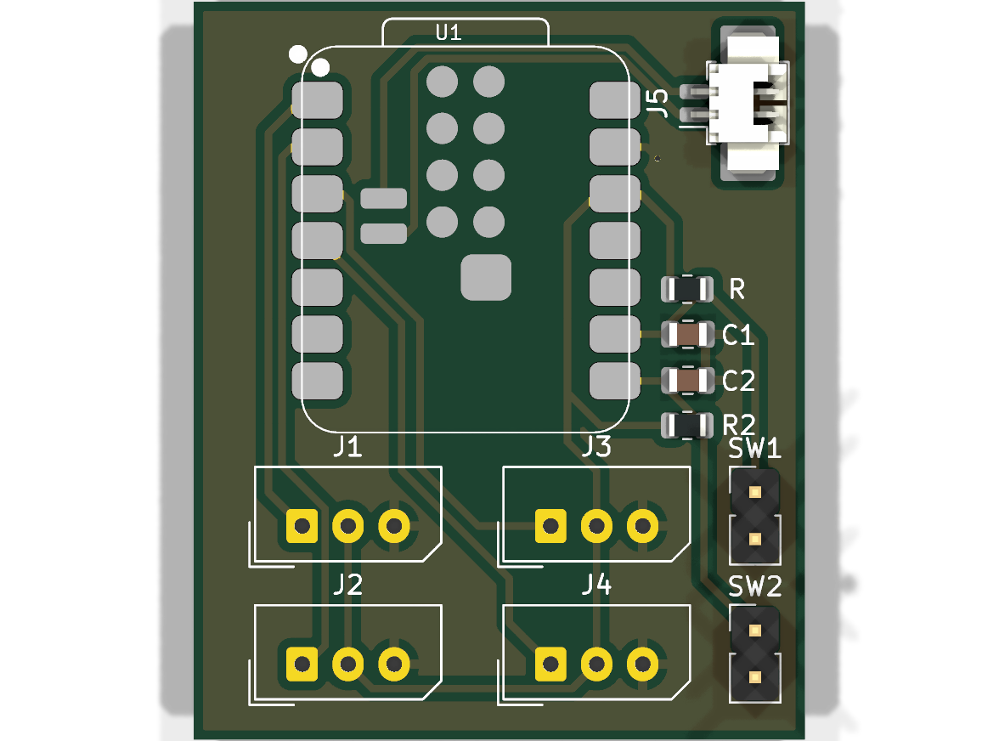
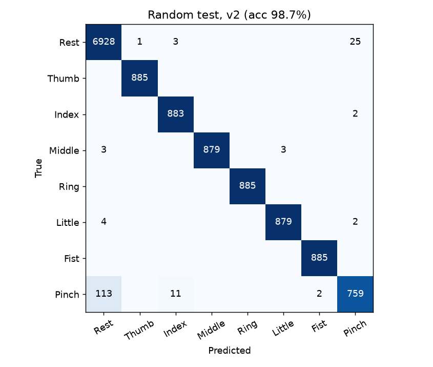
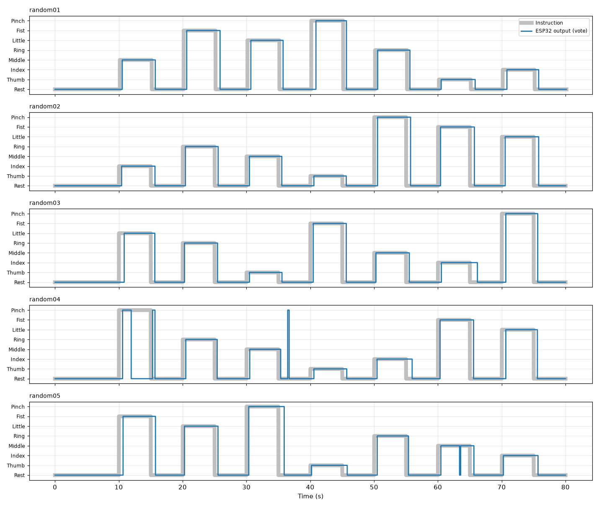

# ReHand — EMG 기반 손가락 동작 인식 의수 제어 (v2)

> 졸업작품 · **2026.01 – 2026.10** · 4인 팀 (팀장) · v2는 2026-11에 추가

전완부 표면 근전도(sEMG) 4채널을 XIAO ESP32-S3로 1 kHz 샘플링하고, **보드 위에서 직접 추론**해 손가락 동작 8가지를 분류한 뒤 ESP-NOW로 의수 보드에 명령과 힘 세기를 보내는 시스템입니다.

이 브랜치(`v2-only`)에는 **스트리밍 특징 + 1D CNN(TCN)** 방식인 v2 파일만 있습니다.

| 브랜치 | 판단 방식 | 내용 |
|---|---|---|
| [`v2-only`](https://github.com/qetad13/rehand-emg-prosthesis/tree/v2-only) | 스트리밍 특징 + 1D CNN(TCN) | v2 파일만 있음 (지금 보고 있는 내용) |
| [`v1-stft-cnn`](https://github.com/qetad13/rehand-emg-prosthesis/tree/v1-stft-cnn) | STFT 스펙트로그램 + 2D CNN | 기존 버전만 있음 |
| [`main`](https://github.com/qetad13/rehand-emg-prosthesis) | 둘 다 | 기존 버전 위에 v2 추가 |

| 항목 | 내용 |
|---|---|
| 입력 | 표면 EMG 4채널, 1000 Hz, 12-bit ADC |
| 출력 | 휴식 / 엄지 / 검지 / 중지 / 약지 / 소지 / 주먹 / 집게 (8클래스) + 힘 세기 1~100 |
| MCU | Seeed XIAO ESP32-S3 (듀얼코어, 샘플링·추론 코어 분리) |
| 모델 | 25 ms마다 계산하는 특징 22개 + 과거만 보는 1D 합성곱 3층, 가중치 5,960개 |
| 통신 | ESP-NOW 양방향 (근전도 보드 ↔ 의수 보드 직접 연결, 자동 페어링) |
| 성능 | 미사용 순서 세션 기준 창 단위 정확도 **98.7%**, 실시간 제어 지연 중앙값 **226 ms** (25 ms마다 판단) |

> **실제 보드·의수에서의 동작 시험은 아직 하지 않았습니다.** 컴파일과 PC 대조 검증까지만 확인했습니다.
> 처음 올릴 때는 [docs/v2_guide.md](docs/v2_guide.md)의 "처음 올릴 때 확인 순서"를 따라 주세요.

사용 방법: [docs/v2_guide.md](docs/v2_guide.md) · 실험과 결과: [docs/v2_results.md](docs/v2_results.md)

---

## 시스템 구조



### 데이터 파이프라인

1. **수집** — 펌웨어를 `MODE_RECORD`로 올리고 GUI가 5초 힘주기 / 5초 쉬기를 안내하며 녹화 (1세션 = 8동작 × 10초 = 80초)
2. **전처리** — 4차 Butterworth HPF 20 Hz + 60 Hz 노치 (PC와 ESP32에서 **같은 SOS 계수**로 계산)
3. **특징** — 25 ms마다 채널별 로그 진폭(휴식 대비) · 주파수 비 2개 · 영교차율과 채널 쌍 상관 6개 = 22개. STFT 없이 누적합만으로 계산
4. **모델** — 과거만 보는 1D 합성곱 3층(폭 24/24/32, 커널 3, 팽창 1/2/4). 최근 0.375초를 보고 25 ms마다 확률 출력. 층마다 지난 결과를 버퍼에 두고 새 프레임만 계산
5. **라벨** — 화면 지시 시각이 아니라 근전도가 실제로 올라온·내려간 시점 기준. 전환 구간은 학습에서 제외
6. **출력 규칙** — 평활한 확률이 0.8 이상이면 켜기, 휴식 3번 연속이면 끄기, 최소 유지 0.1초, 휴식 게이트 1.5배. 손가락 → 다른 손가락은 휴식을 거쳐야 하고 주먹만 예외
7. **내보내기** — 가중치·필터 계수·판단 규칙을 C 헤더로 생성하고, PC 예측값을 테스트 벡터로 함께 내보냄

---

## 폴더 구조

```
rehand-emg-prosthesis/
├─ hardware/                 KiCad 프로젝트 (근전도 보드)
│  ├─ v1/                    초기 보드: 회로도 · PCB · gerber/
│  └─ v2/                    현재 보드 (배터리 · 버튼 추가): 회로도 · PCB · gerber/
├─ collector/                데이터 수집 GUI (PySide6 + pyserial)
│  └─ emg_collector_v4.py
├─ training/                 학습 + ESP32용 C 헤더 생성
│  ├─ train_v2.py            학습: python train_v2.py --cv
│  ├─ emg_data.py            데이터 읽기 · 필터 · 실시간 지표 (train_v2.py가 사용)
│  ├─ host_check.py          펌웨어 C 코드를 PC에서 PyTorch와 대조
│  ├─ data/Fixed/            고정 순서 세션 15개 (학습 / 교차검증)
│  ├─ data/Random/           무작위 순서 세션 5개 (시험 전용)
│  └─ output_v2/             학습 결과 (report, 그림, 모델)
├─ firmware/                 Arduino (XIAO ESP32-S3)
│  ├─ emg_board_v2/          근전도 보드: 녹화 · 점검 · 실시간 판단 · 재생 · 자가 점검
│  └─ hand_board_v2/         의수 보드: 자세 표 · 힘 세기 비례 제어 · 호밍 · 서보 감시
└─ docs/
   ├─ v2_guide.md            사용 안내
   ├─ v2_results.md          결과와 실험 기록
   └─ images/                결과 그림 · 회로도
```

`hardware/v1`, `hardware/v2`는 PCB 버전이고, 판단 방식의 v1/v2와는 관계가 없습니다.

---

## 하드웨어

<p align="center">
  
  
  <br><sub>왼쪽 PCB v1 · 오른쪽 PCB v2 (현재)</sub>
</p>

| | PCB v1 | PCB v2 (현재) |
|---|---|---|
| 크기 | 28.75 × 40 mm | 33.2 × 40 mm |
| MCU 실장 | XIAO ESP32-S3 DIP 풋프린트 | XIAO ESP32-S3 **SMD** 풋프린트 (하단 BAT 패드 사용) |
| 센서 입력 | Molex SPOX 3핀 ×4 (신호 / 3V3 / GND → A0~A3) | 동일 |
| 전원 | USB | **J5 PicoBlade 2핀** → XIAO BAT 패드 (배터리 연결) |
| 입력 버튼 | 없음 | **SW1 · SW2** (D7 · D8), 풀업 저항 + 디바운스 커패시터 (0805) |
| 회로도 | [schematic_v1.svg](docs/images/schematic_v1.svg) | [schematic_v2.svg](docs/images/schematic_v2.svg) |

버튼 동작 (자세한 내용과 LED 표시는 [docs/v2_guide.md](docs/v2_guide.md)):

| 버튼 | 짧게 | 3초 |
|---|---|---|
| SW1 | 근전도 모드 ↔ 매크로 모드 (뗄 때 바뀜) | 사용자 보정 시작 |
| SW2 | 근전도 모드: 잠금 켜기/끄기 · 매크로 모드: 다음 동작 | 의수 호밍 |

스위치가 없는 보드에서는 시리얼 키(`1 2 h c x l ?`)나 BOOT 버튼으로 대신 조작합니다.

---

## 성능

평가는 **학습에 쓰지 않은 Random 세션 5개**(동작 순서를 무작위로 섞어 녹화, 총 6.7분)로 했습니다. 설정은 고정 순서 15세션의 5겹 교차검증만으로 골랐습니다. 비교 대상 v1은 [`v1-stft-cnn`](https://github.com/qetad13/rehand-emg-prosthesis/tree/v1-stft-cnn) 브랜치의 STFT + 2D CNN 방식입니다.

| Random 5세션 | v1 | v2 (이 브랜치) |
|---|---|---|
| 창 단위 정확도 (8클래스) | 96.4% | **98.7%** |
| 창 단위 정확도 (휴식 제외 7동작) | 95.1% | **97.7%** |
| 수축 구간 다수결 | 38/40 | 39/40 |
| 근전도 시작 → 올바른 출력 (중앙값 / 90%) | 356 / 820 ms | **226** / 744 ms |
| 힘 뺀 뒤 출력 해제 (중앙값) | 169 ms | **94 ms** |
| 동작 인식 성공 / 놓침 | 34 / 1 | 35 / 0 |
| 잘못된 손가락 출력 (6.7분) | 3회 | 1회 |
| 휴식 중 오작동 비율 | 0.1% | 0.26% |
| 판단 주기 | 100 ms | 25 ms |
| 1초당 곱셈 수 | 약 300만 | 약 23만 |

클래스별: 휴식 100%, 엄지 100%, 검지 100%, 중지 99%, 약지 100%, 소지 99%, 주먹 100%, 집게 86%

<p align="center">
  
</p>



| 교차검증 (고정 순서 15세션, 20분) | v1 | v2 |
|---|---|---|
| 창 단위 정확도 | 97.6% | **99.1%** |
| 제어 지연 중앙값 / 90% | 298 / 586 ms | **220 / 471 ms** |
| 인식 성공 / 놓침 | 100 / 4 | 104 / 0 |
| 잘못된 손가락 출력 | 28회 | **3회** |
| 휴식 중 오작동 비율 | 0.52% | 0.09% |

알아 둘 점

- 휴식 중 오작동 비율은 Random에서 v1보다 조금 높습니다 (교차검증에서는 낮음).
- 집게가 86%로 가장 약합니다.
- 20세션이 모두 한 번 붙인 상태에서 녹화되어, 전극을 다시 붙였을 때의 성능은 확인하지 못했습니다. 이를 줄이기 위해 사용자 보정(약 40초)을 넣었습니다.
- 지연에는 무선 전송과 서보 반응 시간이 포함되어 있지 않습니다.

실험 내용(특징별 기여, 힘 세기 변화, 보정 효과)은 [docs/v2_results.md](docs/v2_results.md)에 있습니다.

---

## 주요 기능

- **근전도 보드** ([firmware/emg_board_v2](firmware/emg_board_v2))
  - 모드 5개: 녹화(`MODE_RECORD`) · 센서 점검(`MODE_CHECK`) · 실시간 판단(`MODE_RUN`) · 저장 데이터 재생(`MODE_REPLAY`) · 자가 점검(`MODE_SELFTEST`)
  - 사용자 보정: 의수가 동작을 하나씩 보여 주면 따라 하는 방식으로 채널별 이득과 동작별 힘 기준을 다시 맞추고 보드에 저장
  - 잠금 모드: 쥔 상태를 유지한 채 힘을 빼도 풀리지 않게 함
  - 의수 상태(연결 · 호밍 중 · 과열 · 전압 · 서보 응답)를 LED로 표시
- **의수 보드** ([firmware/hand_board_v2](firmware/hand_board_v2))
  - 힘 세기에 비례한 속도와 쥐는 힘, 움직이는 동안 계속 반영
  - "네 손가락 먼저 → 엄지" 순서를 기다리는 동안에도 명령과 무선 수신이 멈추지 않음
  - 호밍을 별도 태스크로 분리, 자세를 표 한 줄로 추가·수정
  - 서보 온도 · 전압 · 응답을 감시해 근전도 보드에 알림
- **PC 대조 검증** ([training/host_check.py](training/host_check.py))
  - 펌웨어의 `emg2.cpp`를 PC에서 그대로 컴파일해 Random 세션 전체(32,014프레임)를 PyTorch와 비교: 확률 차이 최대 8.3e-07, 최종 출력 차이 0

---

## 실행 방법

### 1. 설치
```bash
pip install -r training/requirements.txt -r collector/requirements.txt
```

### 2. 데이터 수집
1. `firmware/emg_board_v2/emg_board_v2.ino`에서 `#define RUN_MODE MODE_CHECK`로 업로드 → 채널 상태 확인
2. `MODE_RECORD`로 업로드 후 `python collector/emg_collector_v4.py`
3. 고정 순서는 `training/data/Fixed/`, 무작위 순서는 `training/data/Random/`에 저장 (순서는 `_order.txt`로 자동 기록)

### 3. 학습과 검증
```bash
python training/train_v2.py --cv
```
```bash
python training/host_check.py
```
`emg2_model.h`, `emg2_test_vectors.h`가 `firmware/emg_board_v2`에 자동 복사됩니다. `host_check.py`는 C++ 컴파일러가 필요합니다 (없으면 `pip install ziglang`).

### 4. 업로드
| 스케치 | 용도 |
|---|---|
| `emg_board_v2` (`MODE_SELFTEST`) | PC 결과와 일치 여부 확인 (`8 / 8 통과`), 판단 1회 계산 시간 |
| `emg_board_v2` (`MODE_RUN`) | 실시간 판단 + ESP-NOW 전송 |
| `emg_board_v2` (`MODE_REPLAY`) | 센서 없이 저장 데이터로 판단 흐름 확인 |
| `hand_board_v2` | 의수 제어 (시리얼에서 `숫자`, `s숫자`, `?`로 단독 시험) |

Arduino IDE 설정: 보드 `XIAO_ESP32S3`, `USB CDC On Boot: Enabled`

---

## 변경 이력

| 날짜 | 변경 내용 |
|---|---|
| 2026-11-12 | **v2**: 스트리밍 특징 + TCN 판단 방식(`train_v2.py`, `emg_board_v2`), 의수 보드 v2(`hand_board_v2`: 힘 세기 비례 제어, 양방향 연결, 호밍 태스크), 사용자 보정, 잠금 모드, PC 대조 검증(`host_check.py`) |
| 2026-09-30 | **PCB v2**: XIAO SMD 실장, 배터리 커넥터, 버튼 2개(풀업 + RC 디바운스) 추가 |

그 전의 개발 과정과 트러블슈팅 기록은 [`v1-stft-cnn`](https://github.com/qetad13/rehand-emg-prosthesis/tree/v1-stft-cnn) 브랜치의 README에 있습니다.

---

## 기술 스택
`Python` `PyTorch` `NumPy/SciPy` `PySide6` · `C/C++ (Arduino, FreeRTOS)` · `KiCad`

## 연락처

| 항목 | 내용 |
|---|---|
| 소속 | 전자공학과 |
| 이메일 | [kjoonh1@gmail.com](mailto:kjoonh1@gmail.com) |
| GitHub | [@qetad13](https://github.com/qetad13) |

## 라이선스 / 출처
- [MIT License](LICENSE) (아래 외부 코드는 각 원본 라이선스를 따름)
- `firmware/emg_board_v2/EMGFilters.*`: OYMotion Inc. (BSD-3-Clause), 채널별 상태 분리 수정
