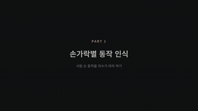
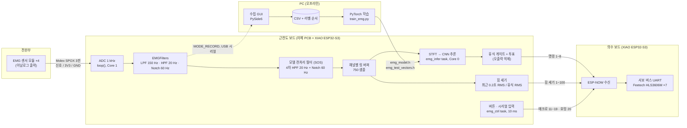
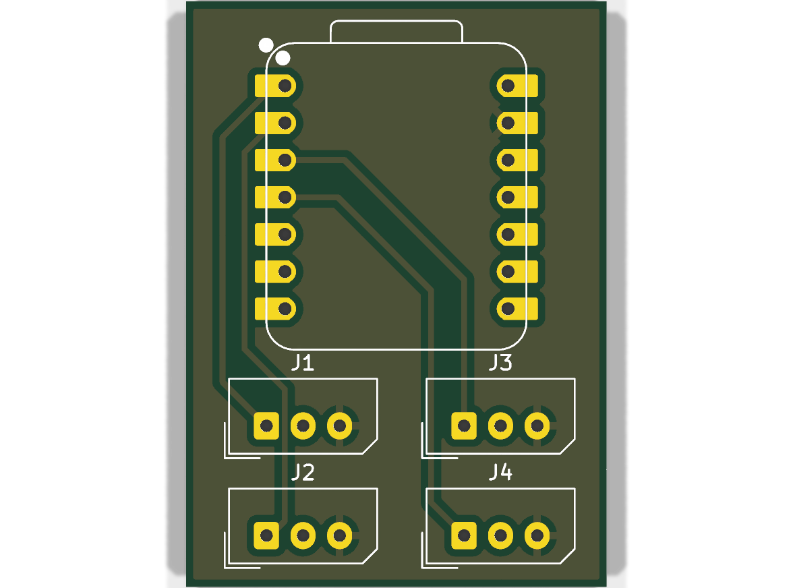
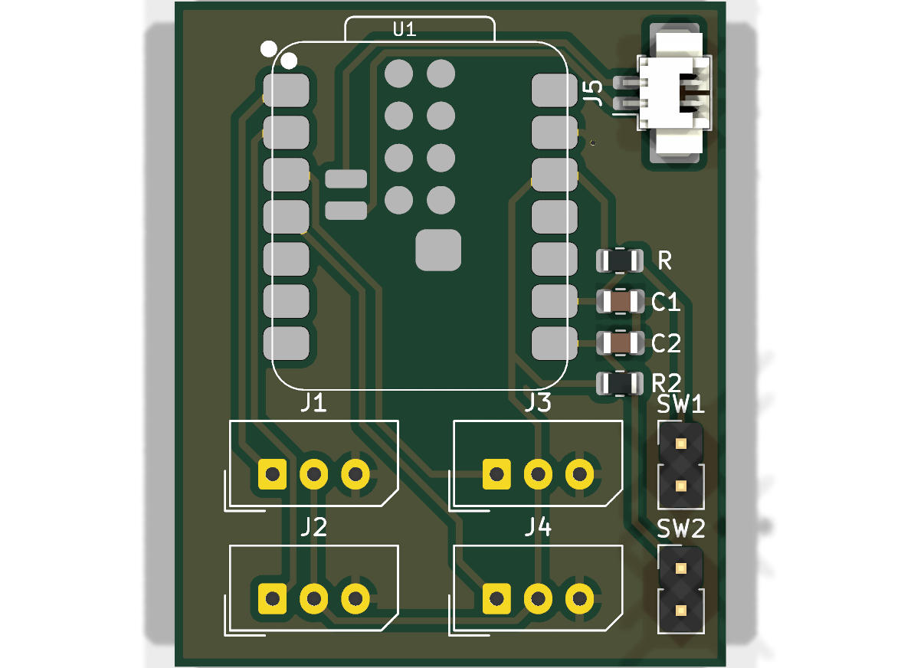
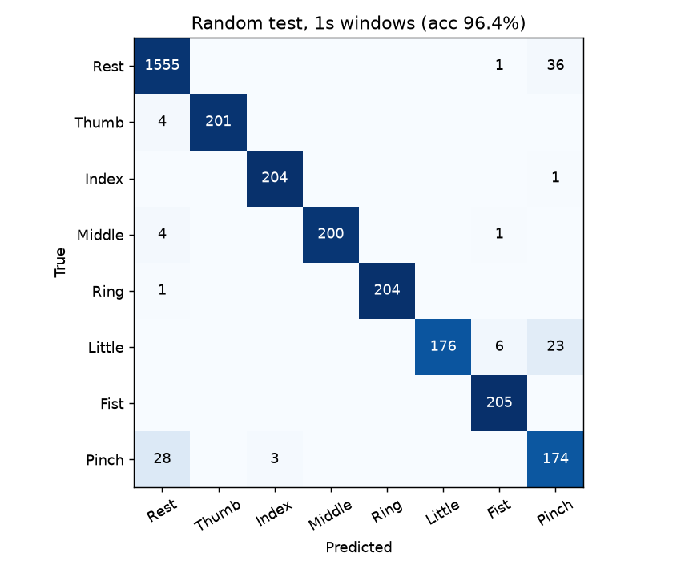
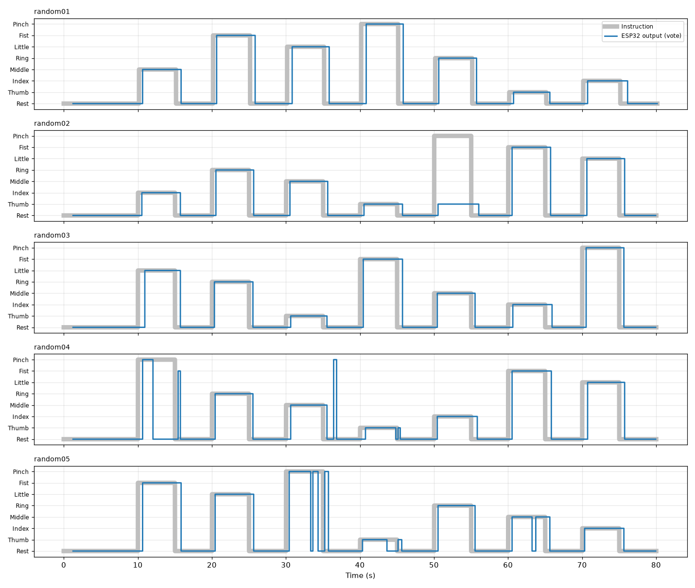

# ReHand — EMG 기반 손가락 동작 인식 의수 제어

> 졸업작품 · **2026.01 – 2026.10** (이후 v2 개선 진행) · 4인 팀 (팀장) · **근전도 센서 파트 담당**

전완부 표면 근전도(sEMG) 4채널을 XIAO ESP32-S3로 1 kHz 샘플링하고, **MCU 위에서 직접 CNN 추론**으로 손가락 동작 8가지를 분류해 ESP-NOW로 의수 보드에 명령을 보내는 시스템입니다.
근전도 보드 PCB → 데이터 수집 GUI → PyTorch 학습 → C 헤더 자동 생성 → 온디바이스 실시간 추론 → 의수로 명령 전송까지를 맡았고, 의수 본체(기구·서보 구동·기본 펌웨어)는 의수 파트 팀원이 만들었습니다 ([역할 분담](#역할-분담)).

<p align="center">
  <a href="docs/media/demo.mp4"></a>
  <br><sub>실제 근전도 보드 + 의수 연동 데모 — <b>v1 최종 판단 방식</b>(STFT + CNN, 0.75초 창 · 100 ms 주기)<br>
  3배속 미리보기, 클릭하면 원본 속도 영상(75초). 손가락별 동작 → 주먹 쥔 상태에서 손가락 제어 → 매크로 모드</sub>
</p>

### 검증 상태 요약

수치마다 **어디서 어떻게 확인했는지**가 다릅니다. 아래 표의 범위를 벗어나는 해석은 하지 않도록 정리했습니다.

| 단계 | v1 (STFT + 2D CNN) | v2 (스트리밍 특징 + TCN) |
|---|---|---|
| PC 오프라인 평가 (녹화 데이터) | 정확도 **96.4%**, 제어 지연 중앙값 **356 ms** | 정확도 **98.7%**, 제어 지연 중앙값 **226 ms** |
| PC ↔ C 구현 일치 | ESP32 보드에서 골든 테스트 **8 / 8 통과** (`esp32_emg_test`) | 펌웨어 C 코드를 PC에서 컴파일해 32,014프레임 대조, 최종 출력 차이 0 (`host_check.py`) |
| ESP32-S3 보드에서 실시간 실행 | 실행함 (데모 영상). **1회 추론 시간 실측값은 기록 없음** | **아직 안 함** (컴파일만 확인) |
| 실제 의수 구동 | 데모 영상으로 동작 확인 (정성적). **의수 포함 지연·정확도 측정은 안 함** | **아직 안 함** |

- 정확도·지연은 모두 **한 번 착용한 상태로 녹화한 20세션**(고정 순서 15 · Random 5, 한 사람)에서 계산한 값입니다.
- 지연은 녹화 데이터에 실제 판단 주기·출력 규칙을 그대로 적용한 **PC 시뮬레이션** 값이며, ESP-NOW 전송·서보 반응 시간은 포함하지 않습니다.
- v1과 v2 수치는 같은 데이터로 계산했지만 학습 구성이 다릅니다 ([성능 및 검증](#7-performance--validation)).

---

## 목차

1. [Project Overview](#1-project-overview)
2. [System Architecture](#2-system-architecture)
3. [Hardware Design](#3-hardware-design)
4. [Firmware & Software](#4-firmware--software)
5. [Implementation](#5-implementation)
6. [Troubleshooting](#6-troubleshooting)
7. [Performance & Validation](#7-performance--validation)
8. [Limitations & Future Work](#8-limitations--future-work)
9. [Repository Structure](#9-repository-structure)

---

## 1. Project Overview

| 항목 | 내용 |
|---|---|
| 목적 | 손가락을 하나씩 구분해 움직이는 근전도 의수 제어기를 **PC 없이 MCU 하나로** 구현 |
| 배경 | 기존(선행) MATLAB 모델은 1회 판단에 곱셈 약 2.3억 번이 필요해 MCU에서 실시간으로 돌릴 수 없었음 |
| 해결하려 한 문제 | ① MCU에 올라가는 크기의 모델로 손가락 8동작 구분 ② 1 kHz 샘플링을 끊지 않으면서 추론 ③ 오출력(엉뚱한 손가락 움직임)과 반응 속도 사이의 균형 ④ PC에서 학습한 결과가 보드에서도 같게 나오는지 확인 |
| 입력 | 표면 EMG 4채널, 1000 Hz, 12-bit ADC |
| 출력 | 휴식 / 엄지 / 검지 / 중지 / 약지 / 소지 / 주먹 / 집게 (8클래스) + 힘 세기(1~100) |

### 역할 분담

| 파트 | 담당 | 내용 |
|---|---|---|
| **근전도 센서 파트** | **본인 (팀장)** | 근전도 보드 PCB(v1·v2), 수집 GUI, 데이터 녹화·품질 검사, 학습·경량화, C 헤더 자동 생성, ESP32-S3 온디바이스 추론·출력 규칙, 힘 세기 계산, ESP-NOW 명령 전송 |
| 의수 연동 | 본인 | 의수 보드의 ESP-NOW 수신부 수정과 명령 처리 ([hand_board_patch.md](docs/hand_board_patch.md)), v2 의수 펌웨어(`hand_board_v2`) 개선 |
| 의수 파트 | 팀원 | 의수 기구·실리콘 외피, 서보 구동, 의수 보드 기본 펌웨어 (호밍 코드 `Homing.cpp` 포함) |

이 저장소는 센서 파트 중심입니다. 의수 기구 설계 파일은 포함하지 않습니다.

---

## 2. System Architecture



### 하드웨어와 소프트웨어 사이의 데이터 흐름 (v1)

1. **센서 → ADC**: 근전도 센서 모듈의 아날로그 출력을 보드의 A0~A3으로 받아 1 ms마다 `analogRead()` (12-bit)
2. **수집 필터**: 채널마다 독립된 `EMGFilters` 인스턴스(LPF 150 Hz, HPF 20 Hz, 60 Hz 노치)를 거침. 녹화와 판단이 **같은 함수**(`readEmgInput()`)를 씀
3. **녹화 경로** (`MODE_RECORD`): 필터 출력 → 16,384샘플 링 버퍼 → 전송 태스크 → USB 시리얼 → PC GUI가 CSV로 저장
4. **판단 경로** (`MODE_RUN`): 필터 출력 → 모델 전처리 필터(학습 때와 같은 SOS 계수) → 채널별 링 버퍼 → 100 ms마다 0.75초 창을 잘라 추론 태스크에 넘김
5. **출력**: CNN 확률 → 휴식 게이트·투표 → 명령 번호와 힘 세기 2바이트를 ESP-NOW로 전송 (판단마다 = 100 ms마다)
6. **의수 보드**: 수신 콜백에서는 플래그만 세우고 `loop()`에서 서보 명령 실행 (WiFi 태스크 안에서 서보 버스를 쓰지 않음)

### 구성 요소별 역할

| 구성 요소 | 역할 |
|---|---|
| EMG 센서 모듈 ×4 | 전극 신호를 증폭해 아날로그 전압으로 출력 (상용 모듈, 자체 설계 아님) |
| 근전도 보드 (XIAO ESP32-S3) | 샘플링, 필터, 추론, 출력 규칙, 힘 세기 계산, 버튼 처리, 무선 송신 |
| 의수 보드 (XIAO ESP32-S3) | ESP-NOW 수신, 서보 7개 위치·속도·토크 명령, 호밍, 상태 감시 |
| PC | 데이터 수집 GUI, 학습, 모델·필터 계수·테스트 벡터를 C 헤더로 내보내기 |

---

## 3. Hardware Design

### 근전도 보드 PCB (KiCad)

<p align="center">
  
  
  <br><sub>KiCad 3D 렌더링 — 왼쪽 v1 · 오른쪽 v2</sub>
</p>

| | v1 | v2 |
|---|---|---|
| 크기 | 28.75 × 40 mm | 33.2 × 40 mm |
| MCU 실장 | XIAO ESP32-S3 DIP 풋프린트 | XIAO ESP32-S3 **SMD** 풋프린트 (하단 BAT 패드 사용) |
| 센서 입력 | Molex SPOX 3핀 ×4 (신호 / 3V3 / GND → A0~A3) | 동일 |
| 전원 | USB | **J5 PicoBlade 2핀** → XIAO BAT 패드 (배터리 연결) |
| 입력 버튼 | 없음 | **SW1 · SW2** (D7 · D8), 풀업 저항 + 디바운스 커패시터 (0805) |
| 회로도 | [schematic_v1.svg](docs/images/schematic_v1.svg) | [schematic_v2.svg](docs/images/schematic_v2.svg) |
| 제작 파일 | [hardware/v1/gerber](hardware/v1/gerber) | [hardware/v2/gerber](hardware/v2/gerber) |

- **보드의 성격**: 근전도 아날로그 프런트엔드(증폭·필터 회로)는 상용 센서 모듈을 사용했고, 자체 PCB는 **MCU 캐리어 + 센서 커넥터 + 전원·버튼 인터페이스** 보드입니다.
- 브레드보드 배선에서 생기던 접촉 불량과 잡음을 줄이기 위해 전용 보드로 제작
- v2에서는 착용형으로 쓰기 위해 배터리 입력을 추가하고, 버튼 2개를 하드웨어 풀업·RC 디바운스와 함께 넣음
  - 펌웨어도 버튼을 별도 FreeRTOS 태스크에서 10 ms마다 읽어 1 kHz 측정 루프에 영향이 없음
  - 스위치가 없는 보드에서는 시리얼 `1`/`2` 또는 BOOT 버튼(짧게/길게)으로 대신 조작

### 의수 보드 (팀원 제작, 연동 부분만 담당)

- XIAO ESP32-S3 + Feetech HLS3606M 서보 7개, 서보 버스는 `Serial2` 1 Mbps UART (`HLSCL` 라이브러리, `SyncWritePosEx`로 7개 동시 명령)
- 기구·외피·서보 배선은 이 저장소에 없습니다.

---

## 4. Firmware & Software

### 개발 환경

| 구분 | 내용 |
|---|---|
| 펌웨어 | Arduino IDE, 보드 `XIAO_ESP32S3`, `USB CDC On Boot: Enabled` (ESP32 Arduino core 위 FreeRTOS) |
| 언어 | C/C++ (펌웨어), Python (수집·학습·검증) |
| 라이브러리 | ESP-NOW · WiFi · Preferences(NVS) (ESP32 core), OYMotion `EMGFilters` (채널별 상태 분리 수정), `HLSCL` (의수 서보) |
| PC | PyTorch, NumPy/SciPy (`butter`, `iirnotch`, `sosfilt`), pandas, PySide6 + pyserial |
| PCB | KiCad |

### 주요 모듈 (v1, `firmware/esp32_emg_realtime`)

| 파일 / 함수 | 역할 |
|---|---|
| `loop()` → `sampleOnce()` | `micros()` 기준 1 ms 간격으로 4채널 읽기. 0.2초 넘게 밀리면 다시 맞추고 `측정 지연` 카운트 |
| `readEmgInput()` | ADC + `EMGFilters`. 녹화와 판단이 공유 (입력 경로 불일치 방지) |
| `emg_infer.cpp` | SOS 필터, Hamming 창 STFT, CNN(BN을 접은 Conv 3층 + GAP + FC), 투표 로직 `emg_vote_update` |
| `inferTaskFn` (Core 0, 우선순위 1) | 알림을 받으면 추론 → 투표 → 힘 세기 → ESP-NOW 전송 |
| `ctrlTaskFn` (Core 0, 우선순위 2) | SW1/SW2/BOOT 버튼과 시리얼 키를 10 ms마다 확인 (모드 전환, 매크로, 호밍) |
| `sendTaskFn` (Core 0, 녹화 모드) | 녹화 링 버퍼를 USB 시리얼로 전송 |
| `emg_model.h` | 학습 스크립트가 생성. 가중치, SOS 계수, 클래스 이름, 투표 파라미터 |

`RUN_MODE` 한 줄로 `MODE_RECORD`(녹화) / `MODE_CHECK`(센서 점검) / `MODE_RUN`(실시간 판단) / `MODE_REPLAY`(저장 데이터로 판단 흐름 확인)를 전환합니다.

### 데이터 처리 과정 (v1)

1. **수집** — GUI가 5초 힘주기 / 5초 쉬기를 안내하며 녹화 (1세션 = 8동작 × 10초 = 80초)
2. **전처리** — 4차 Butterworth HPF 20 Hz + 60 Hz 노치. PC는 `filtfilt`가 아닌 인과 필터 `sosfilt`를 파일 처음부터 연속 적용해 보드와 같은 계수·같은 방향으로 계산
3. **특징** — 0.75초 창마다 채널별 z-score 정규화 → 128점 Hamming 창 STFT(hop 32) → 주파수 밴드 평균 → log 파워 (채널당 18밴드 × 20프레임)
4. **모델** — Conv(8) → Conv(16) → Conv(32) → Global Avg Pool → FC, 파라미터 6,368개(float 약 25 KB). BatchNorm은 내보낼 때 Conv에 접어(fold) 넣음
5. **내보내기** — 가중치·필터 계수·클래스 이름을 C 헤더로 생성하고, PC 예측 확률을 **골든 테스트 벡터**(`emg_test_vectors.h`)로 함께 내보냄
6. **온디바이스** — Core 1은 샘플링만, Core 0은 추론. 출력은 투표 로직을 거쳐 ESP-NOW로 전송

### 통신 및 제어 방식

| 구간 | v1 | v2 |
|---|---|---|
| 근전도 → 의수 | ESP-NOW **방송(broadcast)**, 2바이트 `{명령, 힘 세기}`, 판단마다(100 ms) 현재 명령 재전송 | 8바이트 `RhCmdPacket` (`"RH"`, 세션, 번호, 명령, 힘 세기, 플래그), 0.1초마다 재전송, 상대를 찾으면 1:1 전송 |
| 의수 → 근전도 | 없음 | 10바이트 `RhStatusPacket` (실행한 명령, 상태 플래그, 서보 최고 온도, 전압), 0.2초마다 |
| 중복 실행 방지 | 의수가 같은 명령 반복이면 무시 | (세션, 번호)가 바뀔 때만 실행, 힘 세기는 매 패킷 반영 |
| 연결 상대 | 지정 안 함 | 처음 연결한 근전도 보드 주소를 의수 NVS에 저장, 다른 주소 패킷은 버림. **암호화는 없음** |
| 명령 번호 | 1 엄지 · 2 검지 · 3 중지 · 4 약지 · 5 소지 · 6 휴식(펴기) · 7 주먹 · 8 집게 / 11~19 매크로 / 20 호밍 / 21~24 그립 단계 | 동일 |

---

## 5. Implementation

### 실제로 구현한 기능

- 4채널 1 kHz 수집, 녹화 GUI(동작 순서 안내, 고정/무작위 순서 세션, 순서 파일 자동 저장)
- 학습 전 데이터 품질 검사(접촉 불량 세션 자동 제외, 채널 경고)
- PyTorch 학습 → C 헤더 자동 생성 → 세 스케치 폴더로 자동 복사
- ESP32-S3 온디바이스 STFT + CNN 추론 (100 ms 주기), 추론이 주기 안에 안 끝나면 `판단 건너뜀` 카운트
- 휴식 게이트 + 투표 기반 출력 규칙, 손가락 사이 전환 시 휴식 거치기
- 힘 세기 계산·전송과 의수 속도 반영
- 근전도 / 매크로 모드, 버튼 태스크, 의수 호밍 명령
- PC ↔ ESP32 골든 테스트(`esp32_emg_test`), 단계별 연산 시간 측정 스케치(`esp32_emg_bench`), 센서 없는 재생 모드

### 핵심 설계 결정

**① 샘플링과 추론을 코어로 분리**
1 kHz 샘플링은 Arduino `loop()`(Core 1)에서 `micros()` 기준으로 돌리고, 추론·버튼·전송은 Core 0의 FreeRTOS 태스크로 뺐습니다.
판단 시점이 되면 샘플링 쪽이 링 버퍼를 0.75초 창 버퍼로 펼쳐 복사(`memcpy` 2번)한 뒤 `xTaskNotifyGive`로 추론 태스크를 깨웁니다. 추론 중(`s_busy`)이면 이번 판단을 건너뛰고 횟수만 셉니다.
하드웨어 타이머 인터럽트가 아니라 폴링 방식이라, 밀림 정도는 `측정 지연` 카운터로 확인합니다.

**② 링 버퍼 두 종류**
- 녹화용: `int16 × 4채널 × 16,384샘플`. 샘플링(Core 1)이 `head`, 전송 태스크(Core 0)가 `tail`을 각각 하나씩만 갱신하는 단일 생산자·단일 소비자 구조라 락 없이 씀. 1초 이상 밀리면 오래된 데이터를 버리고 LED로 알림
- 판단용: 채널별 `float × 750샘플` 원형 버퍼. 판단 때만 시간 순서로 펼침

**③ PC와 보드가 같은 계산을 하게 만들기**
필터 계수, STFT 설정, 가중치, 투표 파라미터를 모두 학습 스크립트가 C 헤더로 만들고, 같은 입력에 대한 PC 확률을 테스트 벡터로 함께 내보냅니다. 보드에서는 `esp32_emg_test`로 8개 창을 넣어 PC 결과와 비교합니다.

**④ 동작 종류와 힘 세기를 분리**
CNN은 창마다 채널을 z-score 정규화한 뒤 **모양**만 보므로 힘의 크기를 모릅니다. 그래서 세기는 따로 계산합니다.
- 세기(배) = 최근 0.2초 RMS ÷ 휴식 RMS, 4채널 중 최댓값 (`emg_strength()`)
- 세기(%) = 휴식 게이트 크기를 0%, 동작별 기준을 100%로 환산 → 1~100으로 전송 (휴식·매크로 모드는 0 = 기본 속도)
- 동작별 기준: 같은 힘이어도 동작마다 신호 크기가 크게 달라서(엄지 약 6배, 약지 약 40배) 녹화 20세션의 "인식 직후 0.5초 평균" 중앙값을 동작별로 사용
- 동작 시작 순간은 바로 반영하고 이후 지수 평활(α = 0.5). 단계 출력(약/강, 약/중/강) + 히스테리시스 옵션
- 인식 직후 첫 값은 근전도가 아직 커지는 중이라, 의수 보드는 첫 값으로 속도를 고정하지 않고 움직이는 동안 계속 갱신

**⑤ 출력 규칙 (v1 최종)**
휴식 → 동작은 최근 3번 중 2번, 끄기는 휴식 2번 연속, 최소 유지 0.3초, 휴식 게이트 2.0배(모든 채널 RMS가 휴식 기준의 2배 미만이면 무조건 휴식).
손가락 → 다른 손가락은 반드시 휴식을 거쳐야 바뀌고, 주먹으로만 휴식 없이 바로 바뀝니다(3번 연속). PC 시뮬레이션(`vote_sequence`)과 ESP32(`emg_vote_update`)가 같은 규칙과 같은 파라미터를 씁니다.

### v2에서 바꾼 것 (자세한 내용: [docs/v2_results.md](docs/v2_results.md))

| 항목 | v1 | v2 |
|---|---|---|
| 특징 | 창마다 z-score 정규화 후 STFT (채널 간 크기 비율 정보가 사라짐) | 25 ms마다 22개: 채널별 로그 진폭 · 주파수 비 2종 · 영교차율 + 채널 쌍 상관 6개. FFT 없이 누적 합만으로 계산 |
| 모델 | 2D CNN, 0.75초 창 전체 저장·복사 | 과거만 보는 1D 시간 합성곱(TCN) 3층(24-24-32, dilation 1·2·4), 층마다 작은 링 버퍼를 두고 이번 시점 출력만 계산 |
| 연산량 | 1회 약 30만 곱셈 × 10회/초 | 1회 약 6천 곱셈 × 40회/초 (초당 약 23만) |
| 라벨 | 화면 지시 시각 + 0.1초 기준 | 근전도 포락선이 실제로 오르내린 시점 기준 |
| 출력 규칙 | 횟수 투표 | 평활 확률(계수 0.5) ≥ 0.8이면 켜기, 휴식 3번 연속이면 끄기 |
| 의수 펌웨어 | 팀원 기본 펌웨어 + 수신부 수정 | 힘 세기 비례 속도·쥐는 힘, `loop()`를 멈추지 않는 동작 순서, 호밍 별도 태스크, 서보 온도·전압·응답 감시 |
| 근전도 보드 | 단방향 송신 | 양방향 링크, 의수가 동작을 보여주는 사용자 보정(약 40초, 필요하면 마지막 FC층을 보드에서 다시 맞춤), 잠금 모드 |

---

## 6. Troubleshooting

### 1. 여러 채널이 같은 필터 상태를 공유하는 문제
- **증상**: 채널을 4개로 늘리자 한 채널에 힘을 줘도 다른 채널 파형이 같이 흔들림
- **원인**: 사용하던 `EMGFilters` 라이브러리가 LPF/HPF/노치 필터의 내부 상태를 **파일 전역 변수**로 갖고 있어, 채널마다 객체를 만들어도 상태가 섞임
- **해결**: 필터 상태를 클래스 멤버로 옮겨 인스턴스마다 독립되게 수정 ([EMGFilters.h](firmware/esp32_emg_realtime/EMGFilters.h))

### 2. 녹화 중 샘플 손실 → 라벨 밀림
- **증상**: 80초 녹화인데 CSV 줄 수가 모자라거나, 뒤쪽 동작 구간이 앞 동작 신호와 섞임
- **원인**: 샘플링과 USB 시리얼 전송을 같은 루프에서 하다 보니, PC 쪽 읽기가 잠깐 멈추면 `Serial.write`가 막혀 1 kHz 샘플링이 밀림. 또 GUI가 녹화를 시작하기 전에 쌓인 옛 데이터가 녹화 앞부분에 섞임
- **해결**
  - 샘플링(Core 1)과 전송(Core 0)을 분리하고 16k 샘플 링 버퍼로 연결
  - 1초 이상 밀리면 오래된 데이터를 버리고 실시간으로 다시 맞춤, 이때 LED를 켜서 불량 녹화를 바로 알 수 있게 함
  - 학습 코드에서 길이가 5초 ± 5%를 벗어난 구간은 자동으로 제외

### 3. 시리얼 전송 중 깨진 값
- **증상**: `73-6.0`처럼 두 값이 붙은 줄 때문에 CSV 파싱 실패
- **해결**: 숫자로 변환 불가능한 값은 NaN 처리 후 앞뒤 값으로 채움 (`pd.to_numeric(errors="coerce").ffill()`)

### 4. 센서 접촉 불량 데이터가 학습을 망침
- **증상**: 특정 세션이 섞이면 전체 정확도가 크게 떨어짐. 원인을 찾아보면 전극이 떠 있던 세션
- **해결**: 학습 전 자동 품질 검사 추가
  - 수축 구간 RMS가 휴식 대비 1.3배 미만인 세션 자동 제외
  - 어떤 동작에도 반응하지 않는 채널 / 휴식 때부터 잡음이 큰 채널 경고
  - 펌웨어 `MODE_CHECK`로 녹화 전에 채널별 흔들림 · 클리핑 확인

### 5. 학습과 실시간 입력이 달라서 생기는 정확도 저하
- **증상**: PC 검증 정확도는 높은데 보드에 올리면 판단이 불안정
- **원인**: 녹화용 코드와 판단용 코드의 ADC 읽기·필터 경로가 달랐음
- **해결**
  - 녹화(`MODE_RECORD`)와 판단(`MODE_RUN`)을 한 스케치로 합치고 같은 `readEmgInput()`을 사용
  - PC 필터도 `filtfilt`(양방향) 대신 기기와 같은 인과 필터 `sosfilt`를 파일 처음부터 연속 적용
  - 학습 스크립트가 PC 예측 확률을 `emg_test_vectors.h`로 내보내고, `esp32_emg_test`에서 ESP32 결과와 비교 → **8 / 8 통과**

### 6. MATLAB 모델을 MCU에 올릴 수 없는 문제
- **원인**: 기존 모델은 1회 판단에 약 2.3억 번 곱셈 → ESP32에서 실시간 불가
- **해결**: 입력을 STFT 밴드 평균(채널당 18×20)으로 줄이고, 3층 소형 CNN + Global Average Pooling으로 FC 파라미터를 최소화. BN을 Conv에 접어서 추론 시 연산 제거
- `esp32_emg_bench`로 필터 / STFT / CNN 단계별 시간과 시간영역 특징(MAV·RMS·WL·ZC·SSC) 방식을 비교해 구조를 결정 (측정값은 저장소에 기록하지 않음)

### 7. 반응 속도 vs 오작동 트레이드오프
- **문제**: 1초 창 · 0.5초 주기는 오작동이 0회지만 반응이 1초 가까이 늦어 의수로 쓰기 답답함
- **해결**: 0.5초 창을 50 ms마다 판단하는 빠른 모드 추가, 대신 늘어나는 오판을 규칙으로 억제
  - **휴식 게이트**: 모든 채널 RMS가 휴식 기준의 2배 미만이면 무조건 휴식
  - **히스테리시스 투표**: 켜기는 3회 연속, 다른 동작으로 전환은 5회 연속, 끄기는 휴식 1회
  - 라벨을 창의 "끝부분" 상태 + 사람 반응 지연(50~150 ms)으로 맞춰 힘을 빼면 빨리 풀리도록 학습
- **1차 결과**: 제어 지연 1007 ms → **290 ms**, 해제 394 ms → 104 ms. 하지만 6.7분 동안 엉뚱한 손가락 출력이 **15회**
- **2차 조정**: 전환 5회 → **8회 연속**, 끄기 휴식 1회 → **3회 연속**, **최소 유지 0.5초** 추가
- **2차 결과**: 제어 지연 **290 ms 유지**, 오출력 15회 → **6회**, 대신 해제는 104 ms → 243 ms로 늘어남
- **최종 선택**: 1초 창(오출력 0회, 지연 1007 ms)과 0.5초 창(오출력 6회, 지연 290 ms) 사이인 **0.75초 창 · 100 ms 주기** 하나로 통일 → 정확도 96.4%, 제어 지연 356 ms, 해제 169 ms, 오출력 3회 (6.7분)
- 위 수치는 모두 같은 녹화 데이터의 PC 시뮬레이션 값입니다.

### 8. 시리얼 출력 때문에 추론이 밀림
- **증상**: PC에서 시리얼 모니터를 닫으면 판단 주기가 늘어짐
- **원인**: USB CDC 버퍼가 차면 `Serial.printf`가 블로킹
- **해결**: 판단 모드에서 `Serial.setTxTimeoutMs(0)`로 PC가 안 읽으면 출력 버림, 판단 기록은 출력 변경 시 + 1초마다만 출력

### 9. 의수가 명령을 받지만 움직이지 않음
- **원인 1**: 의수 보드의 ESP-NOW 콜백이 플래그만 세우고 `loop()`에서 확인하지 않음
- **원인 2**: 수신 조건이 `cmd <= 6`이라 새로 추가한 주먹(7) · 집게(8)가 무시됨
- **해결**: `loop()`에서 플래그를 확인해 실행 (서보 버스를 WiFi 태스크 콜백 안에서 쓰지 않도록), 범위를 1~8로 확장. 근전도 보드는 판단할 때마다(현재 100 ms) 현재 명령을 다시 보내 패킷 손실에도 복구 → [docs/hand_board_patch.md](docs/hand_board_patch.md)

---

## 7. Performance & Validation

### 측정 환경

| 항목 | 내용 |
|---|---|
| 데이터 | 한 사람, 한 번 착용한 상태로 녹화한 20세션 (고정 순서 15, Random 5) |
| Random 세션 | 동작 순서를 무작위로 섞어 녹화, 총 6.7분, 수축 40번. 고정 순서만 학습하면 "순서"를 외울 수 있어 테스트 전용으로 분리 |
| v1 학습 | 고정 순서 13세션 학습 + 2세션 검증(조기 종료) |
| v2 학습 | 고정 순서 15세션 모두 학습 (조기 종료 없음). 설정은 고정 순서 15세션 5-fold 교차검증만으로 선택 |
| 지연 정의 | 근전도 포락선 시작 → 올바른 출력까지 (녹화 데이터 시뮬레이션, 무선·서보 시간 미포함) |

### v1 — PC 오프라인 평가 (Random 5세션)

| 지표 | 결과 |
|---|---|
| 창 단위 정확도 (8클래스) | **96.4%** |
| 창 단위 정확도 (휴식 제외 7동작) | 95.1% |
| 수축 구간 다수결 | 95.0% (38/40) |
| 근전도 시작 → 올바른 출력 (중앙값 / 90%) | **356 ms** / 820 ms |
| 힘 뺀 뒤 출력 해제 (중앙값) | 169 ms |
| 동작 인식 성공 / 놓침 | 34 / 1 |
| 잘못된 손가락 출력 (6.7분) | 3회 |
| 휴식 중 오작동 비율 | 0.1% |

클래스별: 휴식 98%, 엄지 98%, 검지 100%, 중지 98%, 약지 100%, 소지 86%, 주먹 100%, 집게 85%

<p align="center">
  
</p>



### v1 — 보드 · 의수 검증

| 항목 | 결과 | 비고 |
|---|---|---|
| ESP32 골든 테스트 (`esp32_emg_test`) | **8 / 8 통과** | PC 확률과 C 구현 확률 비교, 8개 창 |
| 실시간 판단 (`MODE_RUN`) | 보드에서 실행, 데모 영상 촬영 | 100 ms 주기 안에 추론이 끝나는지는 `판단 건너뜀` 카운터로 확인하는 구조. **추론 시간 실측값은 기록 없음** |
| EMG → 의수 구동 | 데모 영상으로 정성적 확인 | 의수까지 포함한 지연·정확도 측정은 하지 않음 |

### 경량화 (계산량, 이론값)

| | 기존 MATLAB 모델 | v1 | v2 |
|---|---|---|---|
| 1회 판단 곱셈 수 | 약 231 M | 0.30 M | 약 6천 |
| 판단 주기 | – | 100 ms | 25 ms |
| 파라미터 | – | 6,368 (≈25 KB) | 5,960 (≈23 KB) |

곱셈 수는 모델 구조로 센 값이고, ESP32-S3에서 잰 실행 시간이 아닙니다.

### v2 — PC 오프라인 평가 (v1과 같은 Random 5세션)

| 지표 | v1 | v2 |
|---|---|---|
| 창 단위 정확도 (8클래스) | 96.4% | **98.7%** |
| 창 단위 정확도 (휴식 제외) | 95.1% | 97.7% |
| 제어 지연 중앙값 / 90% | 356 / 820 ms | **226** / 744 ms |
| 해제 중앙값 | 169 ms | 94 ms |
| 인식 성공 / 놓침 | 34 / 1 | 35 / 0 |
| 잘못된 손가락 출력 (6.7분) | 3회 | 1회 |
| 휴식 중 오작동 비율 | 0.1% | 0.26% |

교차검증(고정 순서 15세션, 5묶음, 수축 104번)에서도 v2가 정확도 99.1% vs 97.6%, 오출력 3회 vs 28회(20분)였습니다.
Random 수축이 40번뿐이라 1번이 2.5%에 해당하므로, 작은 차이는 오차 범위로 봐야 합니다.

### v2 — 구현 검증

| 항목 | 결과 |
|---|---|
| `emg_board_v2` / `hand_board_v2` 컴파일 | 오류·경고 없음 (프로그램 공간 26% / 25%) |
| C 코드 ↔ PyTorch 대조 (`host_check.py`) | Random 5세션 × 2조건 = 32,014프레임, 확률 차이 최대 8.3e-07, 최종 출력 차이 0 |
| 마지막 층 다시 맞추기 (`emg2_adapt_fc`) ↔ PC | PC 대조 못 함 → `MODE_SELFTEST`에 같은 시험을 넣어 둠 (보드 확인 필요) |

### 아직 검증하지 않은 항목

- **v2 전체를 실제 보드와 의수에서 실행** (자가 점검, 실시간 판단, 양방향 링크, 사용자 보정, 잠금 모드, 힘 비례 속도·쥐는 힘)
- v1·v2의 ESP32-S3 **1회 추론 시간 실측값** (`esp32_emg_bench`, `MODE_SELFTEST`로 측정 가능)
- 근전도 시작 → **의수 손가락이 실제로 움직일 때까지**의 종단 지연 (무선 + 서보 포함)
- 다른 날 다시 착용했을 때, 다른 사람이 썼을 때의 성능 (v2는 다른 착용 녹화 1건으로 일부 확인, [v2_results.md 4.1절](docs/v2_results.md))
- 배터리 구동 시간, 장시간 착용 시 전극 상태 변화

---

## 8. Limitations & Future Work

**현재 한계**
- 데이터가 한 사람·한 착용 상태에 집중되어 있어, 정확도 수치를 일반 사용자 성능으로 볼 수 없음
- 근전도 아날로그 프런트엔드는 상용 센서 모듈이라 증폭·필터 회로를 직접 설계하지 않음
- 1 kHz 샘플링이 타이머 인터럽트가 아닌 `loop()` 폴링이라 지터가 남을 수 있음 (밀림 횟수만 기록)
- 추론 시간, 종단 지연 등 보드 위 정량 측정 기록이 부족함
- ESP-NOW 링크는 주소 확인만 하고 암호화가 없음 ([#1](https://github.com/qetad13/rehand-emg-prosthesis/issues/1))
- 집게(85%)·소지(86%)는 다른 동작보다 정확도가 낮음

**개선 방향**
- `esp32_emg_bench`·`MODE_SELFTEST`로 추론 시간을 재서 README에 기록, GPIO 토글 + 오실로스코프로 샘플링 주기 지터와 종단 지연 측정
- 하드웨어 타이머 + ADC 연속 변환(DMA)으로 샘플링 주기를 고정
- v2 펌웨어 실기 검증 후 v1과 같은 조건에서 비교
- 다른 날·다른 사람 녹화를 늘려 교차 세션·교차 사용자 평가
- 아날로그 프런트엔드(계장 증폭기 + 대역통과 필터)를 근전도 보드에 통합하는 PCB v3 검토

---

## 9. Repository Structure

```
rehand-emg-prosthesis/
├─ hardware/                 KiCad 프로젝트 (근전도 보드)
│  ├─ v1/                    초기 보드: 회로도 · PCB · gerber/
│  └─ v2/                    배터리 · 버튼 추가: 회로도 · PCB · gerber/
├─ collector/                데이터 수집 GUI (PySide6 + pyserial)
│  └─ emg_collector_v4.py
├─ training/                 학습 + ESP32용 C 헤더 생성
│  ├─ train_emg.py           v1 학습
│  ├─ train_v2.py            v2 학습 (--cv 교차검증)
│  ├─ host_check.py          v2 펌웨어 C 코드를 PC에서 PyTorch와 대조
│  ├─ data/Fixed/            고정 순서 세션 15개 (학습/검증)
│  ├─ data/Random/           무작위 순서 세션 5개 (테스트 전용)
│  ├─ output/                v1 학습 결과 (report.txt, 모델)
│  └─ output_v2/             v2 학습 결과
├─ firmware/                 Arduino (XIAO ESP32-S3)
│  ├─ esp32_emg_realtime/    v1: 녹화 · 센서 점검 · 실시간 판단 · 재생
│  ├─ esp32_emg_test/        v1: PC ↔ ESP32 결과 일치 검증 (골든 테스트)
│  ├─ esp32_emg_bench/       v1: 단계별 연산 시간 측정 (STFT+CNN vs 시간영역 특징)
│  ├─ emg_board_v2/          v2 근전도 보드: 녹화 · 점검 · 실시간 판단 · 재생 · 자가 점검
│  └─ hand_board_v2/         v2 의수 보드
└─ docs/
   ├─ v2_guide.md            v2 사용 안내
   ├─ v2_results.md          v2 결과와 실험 기록
   ├─ hand_board_patch.md    의수 보드 ESP-NOW 수신부 수정 내역
   ├─ media/                 데모 영상
   └─ images/                회로도, PCB 렌더링, 결과 그림
```

### 브랜치

| 브랜치 | 판단 방식 | 내용 |
|---|---|---|
| `main` · [`v2-streaming-tcn`](https://github.com/qetad13/rehand-emg-prosthesis/tree/v2-streaming-tcn) | 둘 다 | v1 위에 v2 추가 |
| [`v1-stft-cnn`](https://github.com/qetad13/rehand-emg-prosthesis/tree/v1-stft-cnn) | STFT 스펙트로그램 + 2D CNN | v1만 있음 |
| [`v2-only`](https://github.com/qetad13/rehand-emg-prosthesis/tree/v2-only) | 스트리밍 특징 + 1D CNN(TCN) | v2 파일만 있음 |

### 빌드 및 실행 (v1)

```bash
pip install -r training/requirements.txt -r collector/requirements.txt
```

1. **센서 점검**: `firmware/esp32_emg_realtime/esp32_emg_realtime.ino`에서 `#define RUN_MODE MODE_CHECK`로 업로드
2. **녹화**: `MODE_RECORD`로 업로드 후 `python collector/emg_collector_v4.py`. 고정 순서는 `training/data/Fixed/`, 무작위 순서는 `training/data/Random/`에 저장
3. **학습**:
   ```bash
   python training/train_emg.py
   ```
   생성된 `emg_model.h`, `emg_test_vectors.h`가 `firmware/`의 세 스케치 폴더에 자동 복사됩니다.
4. **검증 및 실행**

   | 스케치 | 용도 |
   |---|---|
   | `esp32_emg_test` | PC 결과와 일치 여부 확인 (`8 / 8 통과`) |
   | `esp32_emg_bench` | 단계별 연산 시간 측정 |
   | `esp32_emg_realtime` (`MODE_RUN`) | 실시간 판단 + ESP-NOW 전송 |
   | `esp32_emg_realtime` (`MODE_REPLAY`) | 센서 없이 저장 데이터로 판단 흐름 확인 |

Arduino IDE 설정: 보드 `XIAO_ESP32S3`, `USB CDC On Boot: Enabled`

v2 빌드·업로드·첫 실행 순서는 [docs/v2_guide.md](docs/v2_guide.md)에 있습니다.

---

## 변경 이력

| 날짜 | 변경 내용 |
|---|---|
| 2026-11-20 | **README 구조 정리**: 검증 상태 요약 추가(PC 시뮬레이션 / 보드 / 의수 구분), 필터 체인(EMGFilters + SOS)·샘플링 방식·링 버퍼·태스크 구성을 코드 기준으로 보완, 재전송 주기 표기 수정(0.5초 → 판단마다 100 ms) |
| 2026-11-18 | **문서 정리**: 실제 의수 연동 데모 영상 추가, 역할 분담(센서 파트 담당) 명시, 성능 측정 조건(오프라인 시뮬레이션, 20세션) 표기 |
| 2026-11-13 | **사용자 보정 강화** (v2): 착용 위치가 많이 달라졌거나 다른 사람이 쓸 때 보정 녹화로 모델의 마지막 층을 보드에서 다시 맞춤 (다른 착용 녹화 흉내 64% → 93~96%). `train_v2.py --extra-data`로 다른 날·다른 사람 녹화를 합쳐 학습 |
| 2026-11-12 | **연결 상대 고정** (v2): 의수가 처음 연결된 근전도 보드의 주소를 저장하고 다른 송신기의 명령은 무시. 의수 시리얼 `p` 또는 BOOT 3초로 해제. 암호화는 아직 없음 ([#1](https://github.com/qetad13/rehand-emg-prosthesis/issues/1)) |
| 2026-11-12 | **v2 추가**: 스트리밍 특징 + TCN 판단 방식(`train_v2.py`, `emg_board_v2`), 의수 보드 v2(`hand_board_v2`: 힘 세기 비례 제어, 양방향 연결, 호밍 태스크), 사용자 보정, 잠금 모드, PC 대조 검증(`host_check.py`). 기존 v1 코드는 그대로 유지 |
| 2026-11-02 | **판단 방식 하나로 통일**: 0.75초 창 · 100 ms 주기만 사용. 정확/빠른 모드와 `emg_mode.h` 삭제, 학습은 `python train_emg.py` 하나로 |
| 2026-10-27 | **출력 규칙**: 손가락 → 다른 손가락은 휴식을 거쳐야 바뀜 (주먹은 예외로 바로), 휴식 게이트 2.0 · 끄기 휴식 2번 연속, 시작 시 설정 출력 |
| 2026-10-15 | **호밍 버튼 변경**: 의수 호밍을 SW1 3초에서 근전도 모드의 SW2 3초로 옮김. SW1은 다시 누르는 순간 모드가 바뀌도록 되돌리고, 매크로 모드의 SW2는 그대로 누르는 순간 다음 동작 |
| 2026-10-14 | **모드 선택 / 의수 호밍**: 정확·빠른 모드 모델을 스케치에 함께 두고 `emg_mode.h` 한 줄로 전환. SW1 3초 누르기(또는 시리얼 `h`)로 의수 호밍 명령(20) 전송 |
| 2026-10-07 | **힘 세기 전송**: 동작 종류와 함께 힘 세기(1~100)를 2바이트 패킷으로 전송, 의수 보드에서 서보 속도로 사용. 동작별 100% 기준, 평활화, 단계 출력 옵션, 세기 요약 출력 추가 |
| 2026-10-06 | **근전도 / 매크로 모드**: SW1로 모드 전환, SW2로 매크로 동작(명령 11~19) 선택. 버튼 전용 FreeRTOS 태스크, 시리얼·BOOT 버튼 대체 입력 |
| 2026-10-02 | **빠른 모드 투표 규칙 강화**: 끄기 3회 연속, 전환 8회 연속, 최소 유지 0.5초 추가 → 오출력 15회 → 6회 (6.7분 기준) |
| 2026-09-30 | **PCB v2**: XIAO SMD 실장, 배터리 커넥터, 버튼 2개(풀업 + RC 디바운스) 추가 |
| 2026-09-30 | 저장소 공개: 하드웨어 · 수집 GUI · 학습 · 펌웨어 · 문서 정리 |

---

## 기술 스택
`C/C++ (Arduino-ESP32, FreeRTOS)` `ESP-NOW` · `Python` `PyTorch` `NumPy/SciPy` `PySide6` · `KiCad`

## 연락처

| 항목 | 내용 |
|---|---|
| 소속 | 전자공학과 |
| 이메일 | [kjoonh1@gmail.com](mailto:kjoonh1@gmail.com) |
| GitHub | [@qetad13](https://github.com/qetad13) |

## 라이선스 / 출처
- [MIT License](LICENSE) (아래 외부 코드는 각 원본 라이선스를 따름)
- `firmware/*/EMGFilters.*`: OYMotion Inc. (BSD-3-Clause), 채널별 상태 분리 수정
- `firmware/hand_board_v2/Homing.*`: 의수 파트 팀원 작성 코드
