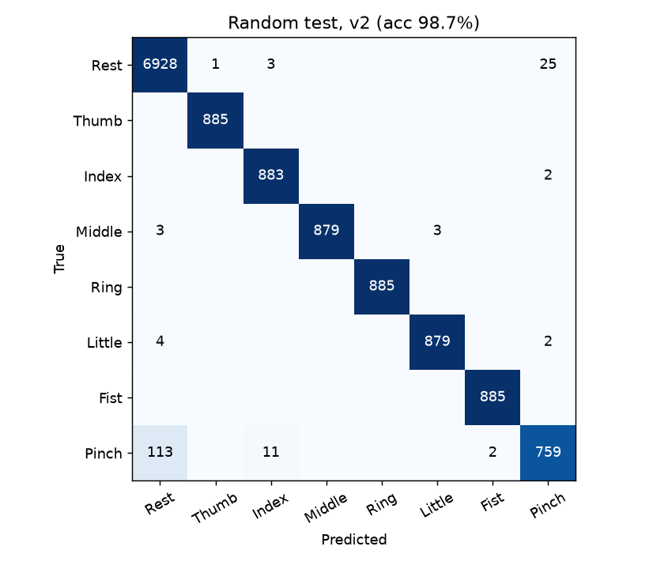
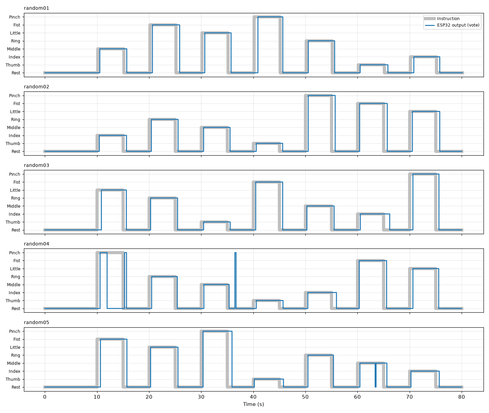

# ReHand v2 결과와 실험 기록

같은 녹화 데이터(고정 순서 15세션 + Random 5세션)로 판단 방식을 다시 만들고, 예전 방식(v1)과 같은 기준으로 비교한 내용입니다.
사용 방법은 [v2_guide.md](v2_guide.md)에 있습니다.

## 1. 한눈에 보기

### Random 세션 (학습에 쓰지 않은 5세션, 6.7분)

| 지표 | v1 (STFT + CNN) | v2 (스트리밍 특징 + TCN) |
|---|---|---|
| 창 단위 정확도 (8클래스) | 96.4% | **98.7%** |
| 창 단위 정확도 (휴식 제외 7동작) | 95.1% | **97.7%** |
| 수축 구간 다수결 | 38/40 | 39/40 |
| 안정 구간 정확도 (실시간 흉내) | 96.5% | 98.7% |
| 근전도 시작 → 올바른 출력 (중앙값) | 356 ms | **226 ms** |
| 근전도 시작 → 올바른 출력 (90%) | 820 ms | 744 ms |
| 힘 뺀 뒤 출력 해제 (중앙값) | 169 ms | **94 ms** |
| 동작 인식 성공 / 놓침 | 34 / 1 | 35 / 0 |
| 잘못된 손가락 출력 | 3회 | 1회 |
| 휴식 중 오작동 비율 | 0.1% | 0.26% |
| 판단 주기 | 100 ms | 25 ms |
| 1회 판단 곱셈 수 | 약 30만 | 약 6천 |
| 1초당 곱셈 수 | 약 300만 | 약 23만 |
| 가중치 | 6,368개 | 5,960개 |

클래스별 (v2): 휴식 100%, 엄지 100%, 검지 100%, 중지 99%, 약지 100%, 소지 99%, 주먹 100%, 집게 86%

  

### 교차검증 (고정 순서 15세션을 5묶음으로, 20분)

Random 세션은 수축이 40번뿐이라 한 번이 2.5%입니다. 설정을 고를 때는 Random을 보지 않고, 고정 순서 세션만으로
"12세션 학습 → 3세션 시험"을 5번 돌린 결과(수축 104번)를 썼습니다. v1도 같은 방법으로 다시 쟀습니다.

| 지표 | v1 | v2 |
|---|---|---|
| 창 단위 정확도 | 97.6% | **99.1%** |
| 안정 구간 정확도 | 96.8% | 99.7% |
| 제어 지연 중앙값 / 90% | 298 / 586 ms | **220 / 471 ms** |
| 해제 중앙값 | 164 ms | 72 ms |
| 인식 성공 / 놓침 | 100 / 4 | 104 / 0 |
| 잘못된 손가락 출력 (20분) | 28회 | **3회** |
| 휴식 중 오작동 비율 | 0.52% | 0.09% |

## 2. 무엇을 바꿨나

### 2.1 특징: "어느 채널이 얼마나 큰지"를 버리지 않기

v1은 0.75초 창마다 채널별로 z-score 정규화를 한 뒤 STFT 모양만 봤습니다. 힘 세기에 덜 민감해지는 장점은 있지만,
손가락 구분에 가장 유용한 정보인 **채널별 크기 비율**이 사라집니다. 녹화 데이터에서 동작별 "쉴 때 대비 신호 크기"는 이렇습니다.

| 동작 | Ch 00 | Ch 01 | Ch 02 | Ch 03 |
|---|---|---|---|---|
| 엄지 | 3.4 | 1.5 | 2.5 | 3.5 |
| 검지 | 4.9 | 2.8 | 2.1 | 3.0 |
| 중지 | 6.9 | 12.1 | 3.8 | 2.8 |
| 약지 | 2.2 | 25.3 | 3.1 | 2.4 |
| 소지 | 3.3 | 5.3 | 4.0 | 4.3 |
| 주먹 | 5.0 | 6.4 | 4.9 | 13.4 |
| 집게 | 2.2 | 1.5 | 1.6 | 3.5 |

v2는 25 ms마다 아래 22개 값을 계산합니다. FFT가 필요 없고, 샘플이 들어올 때마다 더하기만 하면 됩니다.

| 특징 | 개수 | 의미 |
|---|---|---|
| 로그 진폭 | 4 | 최근 50 ms 신호 크기 (쉴 때 = 0) |
| 주파수 비 1 | 4 | 1차 차분 크기 ÷ 신호 크기 (평균 주파수에 해당, 크기와 무관) |
| 주파수 비 2 | 4 | 2차 차분 크기 ÷ 1차 차분 크기 |
| 영교차율 | 4 | 부호가 바뀐 비율 |
| 채널 쌍 상관 | 6 | 두 채널이 같이 움직이는 정도 |

특징을 하나씩 뺀 교차검증 결과(창 단위 정확도): 전부 사용 99.2% / 상관 제외 98.9% / 로그 진폭만 98.0% /
로그 진폭 제외 98.1%. 크기 정보가 없어도 v1(97.6%)보다 높고, 둘을 함께 쓸 때 가장 좋았습니다.

### 2.2 모델: 과거만 보는 1D 시간 합성곱 (TCN)

- 3층(24-24-32채널, 탭 3개, 간격 1·2·4) + 전결합층. 최근 15프레임 = 0.375초를 봅니다.
- 층마다 과거 입력을 작은 링 버퍼에 두고 **이번 시점의 출력 하나만** 계산하므로 1회 판단이 약 6천 곱셈입니다.
- 0.75초 창 전체(3000개 float)를 저장하고 복사할 필요가 없습니다.

모델 크기·보는 범위·프레임 길이를 바꾼 17가지 변형을 교차검증했지만 차이가 모두 오차 범위(수축 104번 중 1~2번) 안이라
기본 구성을 그대로 썼습니다.

### 2.3 라벨: 실제 근전도 시작/끝 기준

v1은 "화면 지시 시각 + 0.1초"를 경계로 보고 앞뒤 0.2초를 제외했습니다. 실제 반응 시간은 매번 달라서 경계 근처 라벨이 부정확합니다.
v2는 근전도 포락선이 실제로 올라온/내려간 시점(제어 지연을 잴 때 쓰는 것과 같은 정의)을 경계로 쓰고,
시작 직후 50 ms처럼 아직 구분할 수 없는 구간만 손실에서 제외합니다. 빠른 반응과 빠른 해제를 직접 학습합니다.

### 2.4 출력 규칙: 횟수 투표 → 확률 문턱

25 ms마다 판단하면 "3번 중 2번" 같은 투표는 수축 초반의 애매한 판단에 쉽게 넘어갑니다. 한 번 엉뚱한 손가락이 켜지면
"휴식을 거쳐야 바꿀 수 있다"는 규칙 때문에 그 수축 전체를 놓칩니다 (처음 시도에서 104번 중 22번을 놓침).

v2는 확률을 평활(계수 0.5)한 값이 **0.8 이상**일 때만 켭니다. 끄기는 휴식 판단 3번 연속(75 ms), 손가락 → 주먹만
휴식 없이 전환(평활 확률 0.9 이상 6번 연속), 최소 유지 0.1초, 휴식 게이트 1.5배입니다.
문턱을 0.9로 올리면 오출력이 3 → 2회로 줄지만 지연이 220 → 274 ms로 늘어 0.8을 골랐습니다 (`train_v2.py`의 `th_on`).

### 2.5 학습 데이터 늘리기

- **전극 이득 변화**: 로그 진폭에 상수(공통 σ 0.15 + 채널별 σ 0.10)를 더함
- **힘 세기 변화**: 세션마다 복사본을 하나 만들어, 수축 구간마다 신호를 0.5~2배로 바꿈.
  약하게 만들 때는 줄어든 만큼 같은 세션의 휴식 신호를 더해 잡음 크기를 유지 (실제로 약하게 힘주면 근전도만 작아지기 때문)

## 3. 힘 세기에 대한 견고성

"크기 정보를 쓰면 약하게/세게 힘줄 때 틀리지 않나"를 확인하려고, 시험 세션의 수축 구간을 위와 같은 방법으로 바꿔서 쟀습니다
(교차검증, 휴식 제외 창 단위 정확도 / 인식 성공 / 오출력).

| 신호 크기 | v1 | v2 (힘 증강 없음) | v2 (최종) |
|---|---|---|---|
| 0.35배 | 65.8% · 98/104 · 43회 | 68.6% · 101/104 · 8회 | 77.6% · 102/104 · 9회 |
| 0.5배 | 85.1% · 102/104 · 30회 | 89.0% · 103/104 · 5회 | 92.1% · 104/104 · 5회 |
| 0.7배 | 95.0% · 102/104 · 24회 | 96.6% · 104/104 · 4회 | 97.9% · 104/104 · 3회 |
| 1배 (녹화 그대로) | 98.0% · 100/104 · 28회 | 99.6% · 104/104 · 3회 | 99.7% · 104/104 · 3회 |
| 1.5배 | 98.0% · 95/104 · 33회 | 99.4% · 103/104 · 5회 | 99.7% · 104/104 · 4회 |
| 2배 | 98.0% · 93/104 · 36회 | 98.3% · 102/104 · 7회 | 99.5% · 102/104 · 7회 |

- v2는 모든 힘 수준에서 v1 이상입니다.
- 복사본을 2~3개로 늘리면 0.5배에서 94~95%까지 오르지만 평소 힘에서 오출력이 3 → 6~8회로 늘어, 손해가 없는 1개를 골랐습니다.
- 한계: 신호를 곱해서 만든 흉내입니다. 실제로 약하게 힘주면 근육이 쓰이는 패턴 자체도 조금 달라지므로,
  약한 힘/센 힘으로 녹화한 세션을 추가하면 더 정확히 확인하고 개선할 수 있습니다.

## 4. 전극을 다시 붙였을 때 (사용자 보정)

채널별 이득만 임의로 바꾼 흉내입니다 (경계 구간까지 포함한 프레임 단위 정확도, Random 1세션으로 보정 → 나머지 4세션 시험).

| 채널별 이득 | 보정 없음 | 사용자 보정 후 |
|---|---|---|
| 변화 없음 | 95.7% | – |
| 0.6 ~ 1.6배 | 95.0% | 95.6% |
| 0.4 ~ 2.5배 | 90.7% | 95.6% |

이득이 조금 달라지는 정도는 모델이 이미 견디고, 크게 달라지면 보정으로 회복됩니다.

**확인하지 못한 것**: 녹화 20세션은 쉴 때 신호 크기가 세션끼리 거의 같아서 한 번 붙인 상태로 녹화한 것으로 보입니다.
전극 **위치**가 달라졌을 때(다른 날, 다시 착용)의 성능은 이 데이터로는 알 수 없습니다. v1도 마찬가지입니다.
다른 날 다시 붙여서 Random 세션을 몇 개 녹화해 두면 가장 중요한 이 부분을 확인할 수 있습니다.

## 5. 펌웨어 검증

| 항목 | 결과 |
|---|---|
| `emg_board_v2` 컴파일 (XIAO ESP32-S3, 5개 모드) | 오류·경고 없음, 프로그램 공간 26% |
| `hand_board_v2` 컴파일 (ESP-NOW 직접 연결) | 오류·경고 없음, 프로그램 공간 25% |
| C 코드 ↔ PyTorch 대조 (`host_check.py`) | Random 5세션 × 2조건 = 32,014프레임, 확률 차이 최대 8.3e-07, 최종 출력 차이 0 |
| 실제 보드에서 실행 | **아직 안 함** → `MODE_SELFTEST`로 확인 필요 |
| 의수 동작 (속도·힘 비례, 엄지 순서, 호밍 태스크) | **아직 안 함** → [v2_guide.md](v2_guide.md)의 확인 순서 참고 |

`host_check.py`는 펌웨어의 `emg2.cpp`를 PC용으로 그대로 컴파일해 세션 전체를 흘려보내고, 25 ms마다의 확률·힘 세기·최종 출력을
`train_v2.py`의 계산과 비교합니다. v1의 골든 테스트(8개 창)보다 훨씬 넓게 확인합니다.

## 6. 비교할 때 알아 둘 점

- v1의 Random 수치는 기존 `training/output/report.txt`의 값입니다 (13세션 학습 + 2세션 검증).
  v2는 조기 종료를 쓰지 않아 검증 세션이 필요 없으므로 15세션을 모두 학습에 썼습니다.
- v2의 설정(특징, 모델, 문턱, 증강)은 교차검증만으로 골랐고 Random은 확정 뒤에 쟀습니다.
  다만 개발 중 Random 결과를 한 번 본 뒤에 힘 증강을 추가했습니다(선택 자체는 교차검증 기준).
- 지연·오출력 지표는 v1의 `realtime_metrics`를 그대로 썼습니다. 실제 보드에서는 여기에 무선 전송과 서보 반응 시간이 더해집니다.
